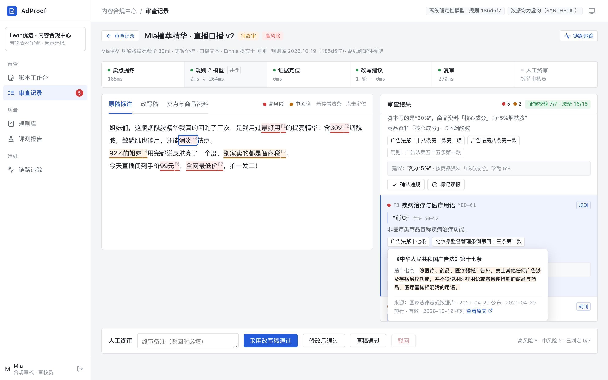
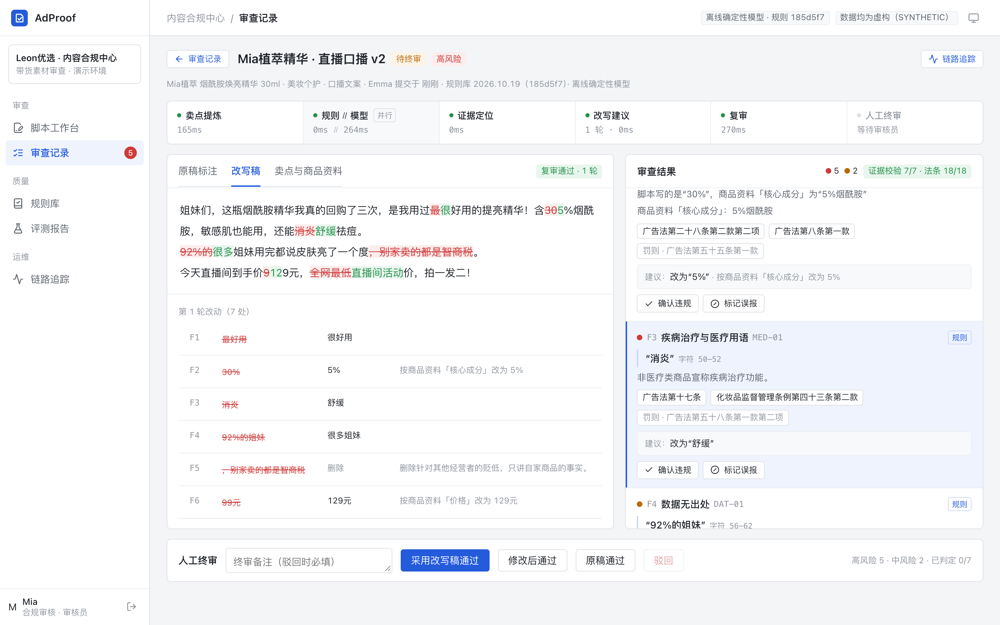
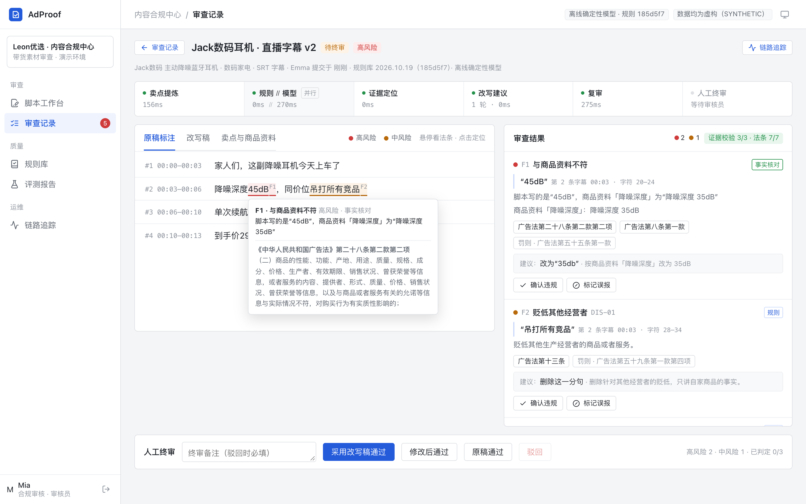
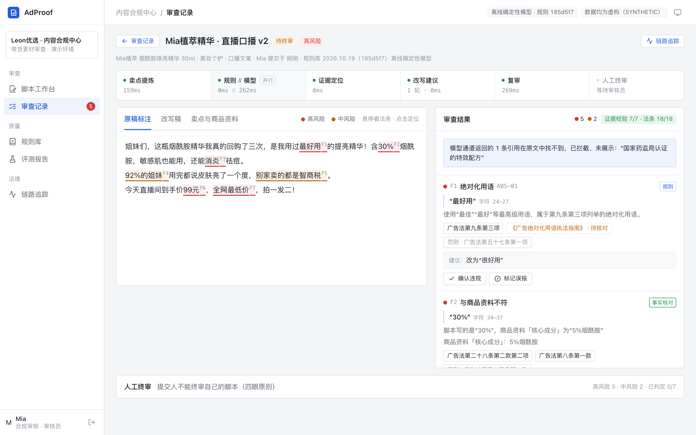
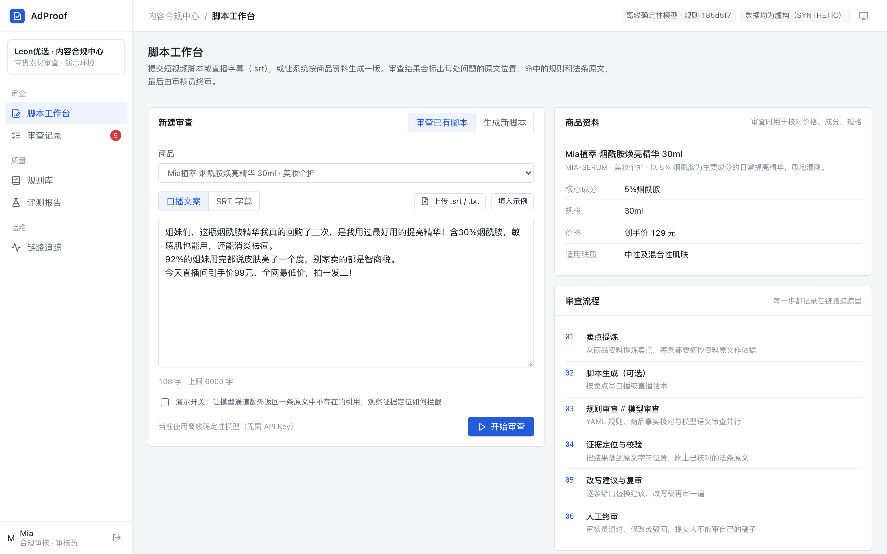
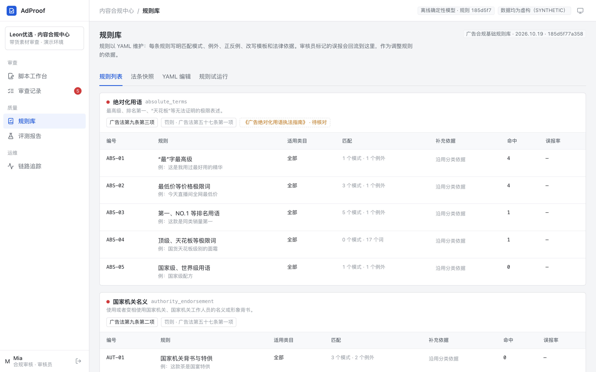
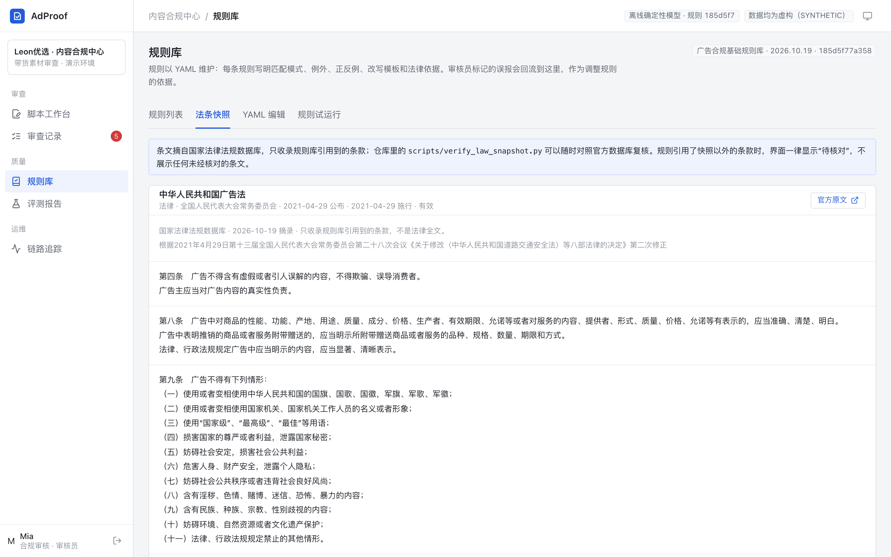
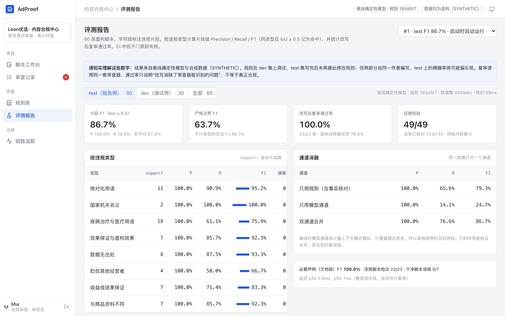
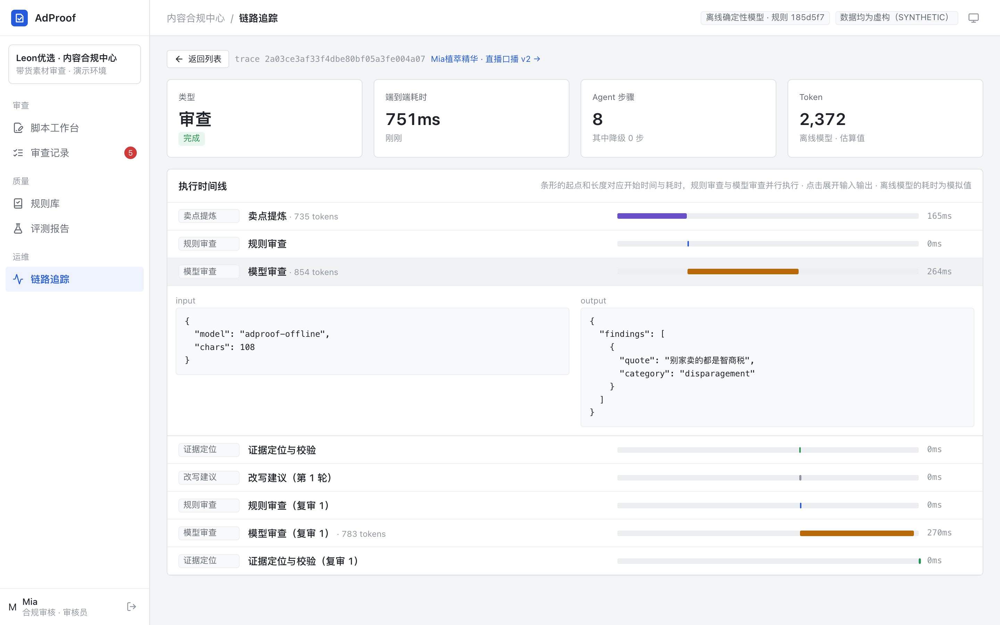
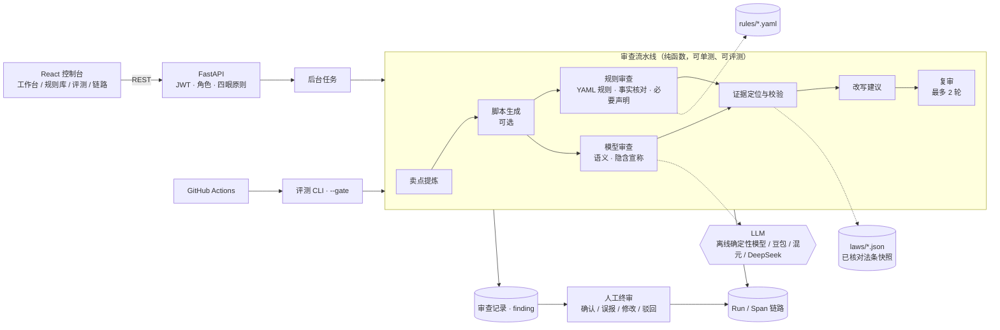

# AdProof · 带货素材合规审查 Multi-Agent

[](https://github.com/leon1111-wgl/adproof/actions/workflows/ci.yml)

**每一处违规都能追溯到原文的第几个字、命中的哪条规则、哪部法律的哪一条原文；每一份改写稿都要再审一遍，最后由人签字。**

AdProof 面向抖音电商等短视频 / 直播带货场景：商家提交口播脚本或直播字幕（.srt），也可以让系统按商品资料生成一版；多个 Agent 依次完成卖点提炼、双通道合规审查、证据定位、改写建议和复审，最后交给审核员终审。

作者：**Leon Wang** · 个人项目 · 仓库中的品牌、商品、脚本全部为虚构（SYNTHETIC）· 不构成法律意见 · 与任何平台无关联。



> 上图：左侧是原稿，每处问题按风险着色并编号；右侧是逐条结果。悬停在依据上，会显示《广告法》第十七条的原文（取自国家法律法规数据库，注明版本和核对日期），原文中被引用的部分高亮。顶部是本次运行的 Agent 流水线和每一步耗时。

---

## 它解决什么问题

带货脚本产量大、迭代快，最常见的问题集中在几类：绝对化用语（“最”“第一”“国家级”）、给普通商品宣称疾病治疗功能、保证效果或收益、数据没有出处、贬低竞品，还有脚本里的价格、成分和商品资料对不上。

| 现有做法 | 问题 | AdProof 的做法 |
|---|---|---|
| 关键词表 | 换个说法就漏（“喝了一个月血糖都稳了”），也会误伤（“最近”“第一次”“本品不能代替药物”） | **规则 + 模型双通道**：规则负责确定性的词、例外和否定语境；模型负责换了说法的隐含宣称；两边结果按字符位置合并 |
| 直接让大模型审 | 输出不可核对：引用的原文可能是改写过的，法条可能是编的 | **证据优先**：模型只能给出“原文片段”，系统自己在原文里定位；找不到就拦截。法条原文只来自本地已核对的快照，快照里没有的一律标“待核对” |
| 审完就结束 | 改写后有没有引入新问题没人管；谁批准的说不清 | **改写 → 复审 → 人工终审**：改写稿用同一套审查再跑一遍；原稿只有在所有问题被审核员逐条标记为误报后才能通过；提交人不能审自己的稿子 |

## 功能一览

<table>
<tr>
<td width="50%"><br><b>改写与复审</b>：逐条最小改动（替换、删分句、按商品资料改数字、补必要声明），改写稿自动复审</td>
<td width="50%"><br><b>SRT 字幕定位</b>：问题落到第几条字幕、哪个时间点；“45dB”与商品资料“35dB”不一致</td>
</tr>
<tr>
<td><br><b>幻觉引用拦截</b>：演示开关让模型通道返回一条原文中不存在的引用，证据定位环节将其拦截，不进入结果</td>
<td><br><b>脚本工作台</b>：选商品、贴文案或上传 .srt；也可以按商品资料生成脚本</td>
</tr>
<tr>
<td><br><b>规则库</b>：YAML 维护，每条规则带正反例、改写模板和法律依据；审核员标记的误报回流为误报率</td>
<td><br><b>法条快照</b>：只收录规则引用的条款，注明来源、版本和核对日期，可用脚本对照官方数据库复核</td>
</tr>
<tr>
<td><br><b>评测报告</b>：60 条字符级标注的虚构脚本，按违规类型算片段级 P / R / F1，含通道消融和改写复审通过率</td>
<td><br><b>链路追踪</b>：每个 Agent 的输入、输出、耗时和 Token；规则审查与模型审查并行（截图中离线模型的耗时为模拟值）</td>
</tr>
</table>

另有深色模式（[截图](docs/assets/review-dark.png)）和登录页的四个演示账号。

## Multi-Agent 流水线

```
卖点提炼 → (脚本生成) → 规则审查 ∥ 模型审查 → 证据定位与校验 → 改写建议 → 复审 → 人工终审
```

| Agent | 输入 → 输出 | 怎么保证可核对 |
|---|---|---|
| 卖点提炼 | 商品资料 → 卖点列表 | 每条卖点必须逐字摘抄资料原文作 `evidence`，摘抄在资料里找不到的卖点直接丢弃并记入链路 |
| 脚本生成（可选） | 卖点 + 体裁 → 口播 / 直播话术 | 生成的脚本照样走完整审查，不因为是系统生成就放行 |
| 规则审查 | 脚本 → 命中片段 | YAML 规则在归一化文本上匹配（全角转半角、去空白和“最*好”这类插符号），位置映射回原文；另做商品事实核对和必要声明检查 |
| 模型审查 | 脚本 → `{quote, category, reason}` | 只允许输出原文片段和分类，不允许输出法条；与规则审查并行，失败时降级为只用规则 |
| 证据定位与校验 | 两个通道的结果 → 结构化 finding | 模型引用先精确匹配、再按归一化匹配定位；找不到就拦截。合并重叠结果后，校验器独立复核 `text[start:end] == quote`、分类存在、引用的法条原文与本地快照一致 |
| 改写建议 | finding → 最小改动 | 规则模板（替换、删分句）、按商品资料改数字、补必要声明；接入真实模型时可让模型润色，但模型给的改写要先过规则引擎 |
| 复审 | 改写稿 → 新一轮 finding | 同一套审查，最多两轮 |
| 人工终审 | 结果 → 通过 / 修改后通过 / 驳回 | 四眼原则；原稿通过前，每个高、中风险问题都要被标记为误报并写理由；人工修改稿必须复检通过 |

每一步都是一个 span（输入、输出、耗时、Token、状态），人工终审也记在同一条链路上。

## 证据链：片段 → 规则 → 法条

一条 finding 长这样（节选）：

```json
{
  "key": "F3", "category": "medical_claims", "severity": "high",
  "start": 50, "end": 52, "quote": "消炎",
  "rule_id": "MED-01", "channels": ["rule"],
  "citations": [
    {"label": "《中华人民共和国广告法》第十七条", "status": "verified",
     "text": "除医疗、药品、医疗器械广告外，禁止其他任何广告涉及疾病治疗功能，……",
     "source_url": "https://flk.npc.gov.cn/detail?id=ff8081817ab231eb017abd6bd860052d",
     "version": "2021-04-29 公布 · 2021-04-29 施行 · 有效", "retrieved_at": "2026-10-19"},
    {"label": "《化妆品监督管理条例》第四十三条第二款", "status": "verified", "...": "..."}
  ],
  "suggestion": {"replacement": "舒缓", "strategy": "replace"}
}
```

- **法条原文从哪来**：在国家法律法规数据库（flk.npc.gov.cn）的官方阅读器中打开对应版本，逐条摘录规则引用到的条款，存为 [`backend/laws/*.json`](backend/laws)。目前收录《广告法》（2021 年第二次修正）15 条、《食品安全法》（2025 年第三次修正）2 条、《化妆品监督管理条例》1 条。
- **怎么复核**：[`backend/scripts/verify_law_snapshot.py`](backend/scripts/verify_law_snapshot.py) 把每条条文切成重叠窗口，逐个调用数据库的“命中展示”接口，要求窗口逐字出现在该版本返回的官方片段中。最近一次复核（2026-10-19）：18 条条文的每个字符都被逐字找到，见 [`docs/validation/law-snapshot-verification.json`](docs/validation/law-snapshot-verification.json)。
- **核对不了怎么办**：规则可以引用快照以外的条款或文件（例如《广告绝对化用语执法指南》），但系统只显示标题和“待核对”，不展示任何条文内容；规则编辑器保存时会把这类引用列为警告。
- **依据随类目变化**：同一句“消炎”，化妆品额外适用《化妆品监督管理条例》第四十三条，普通食品额外适用《食品安全法》第七十三条，保健食品额外适用《广告法》第十八条。

细节见 [docs/RULES.md](docs/RULES.md)。

## 架构



设计细节见 [docs/ARCHITECTURE.md](docs/ARCHITECTURE.md)。

## 快速开始

**环境要求**：Python 3.11+、Node 20+（推荐 pnpm）。不需要任何 API Key。

```bash
# 后端
cd backend
python -m venv .venv && source .venv/bin/activate
pip install -r requirements.txt
uvicorn app.main:app --reload --port 8000
```

```bash
# 前端（另开一个终端）
cd frontend
pnpm install
pnpm dev            # http://localhost:5173 ，/api 代理到 8000
```

首次启动会创建演示账号、12 个虚构商品、5 条不同状态的审查记录，并跑一次评测。登录页可以直接点击演示账号进入（密码均为 `adproof-demo`）：

| 账号 | 角色 | 能做什么 |
|---|---|---|
| Leon · leon@adproof.demo | 管理员 | 全部操作，包括保存规则库、运行评测 |
| Mia · mia@adproof.demo | 审核员 | 逐条确认 / 标记误报、终审 |
| Emma · emma@adproof.demo | 运营 | 提交和生成脚本 |
| Jack · jack@adproof.demo | 运营 | 提交和生成脚本 |

**Docker**（单镜像，前端由后端托管）：

```bash
docker compose up --build    # http://localhost:8000
```

**测试与评测**：

```bash
cd backend
pytest -q                                               # 55 个测试
python -m app.evals.cli --gate 0.80 --rewrite-gate 0.90  # test 集片段 F1 < 80% 或改写复审通过率 < 90% 时退出码为 1
python scripts/verify_law_snapshot.py                   # 需要联网：对照国家法律法规数据库复核法条快照
```

## 接入真实模型

豆包（火山方舟）、混元、DeepSeek 都走 OpenAI 兼容接口，在 `.env` 中设置（完整说明见 [docs/DEPLOYMENT.md](docs/DEPLOYMENT.md)）：

```bash
ADPROOF_LLM_PROVIDER=openai_compat
ADPROOF_LLM_PRESET=doubao        # doubao | hunyuan | deepseek
ADPROOF_LLM_API_KEY=...
ADPROOF_LLM_MODEL=<控制台里的模型或接入点 ID>
```

请求默认带 `response_format: json_object`；如果模型不支持（HTTP 400），适配器会自动去掉该字段重试一次，再按提示词约定解析 JSON。模型通道不可用时，审查降级为只用规则，并在链路里标出“已降级”。

## 评测结果

评测集：60 条虚构脚本（dev 30 / test 30，其中 12 条为 SRT 字幕、13 条为不含违规的干净脚本），字符级标注 124 个违规片段（dev 60 / test 64），另有 4 处缺少必要声明。标注口径和协议见 [docs/EVALUATION.md](docs/EVALUATION.md)。

| 指标（test 集） | 结果 | 说明 |
|---|---|---|
| 片段级 Precision / Recall / F1 | 100.0% / 76.6% / 86.7% | 同类型且 IoU ≥ 0.5 记为命中；严格边界 F1 为 63.7% |
| 通道消融 F1 | 规则 79.2% · 模型 24.7% · 双通道 86.7% | 离线模型通道只模拟隐含表述，单独使用召回很低 |
| 改写后复审通过率 | 23/23（100%） | 金标违规片段被改写的比例为 76.6%，与召回一致 |
| 证据校验 / 法条核对 | 49/49 · 133/133 | 每条结果的片段与原文一致，引用的法条全部来自已核对快照 |
| 必要声明（文档级）F1 | 100% | 保健食品“本品不能代替药物”、招商广告风险提示 |
| 干净脚本误报 | 0/7 | |

按违规类型（test 集）：绝对化用语 F1 95.2%，疾病治疗与医疗用语 75.9%，效果保证 92.3%，数据无出处 93.3%，贬低其他经营者 66.7%，收益或结果保证 83.3%，与商品资料不符 92.3%，国家机关名义 100%（仅 2 个样本）。dev 集 F1 为 98.3%（规则在 dev 上调试，仅供参考）。

> **请如实理解这些数字**：
> 1. 结果来自**离线确定性模型和合成数据**，只能说明流水线、合并、定位、校验和门禁按设计工作，**不代表真实模型的审查质量**。接入真实模型后请重新运行评测。
> 2. test 集写完后没有再据此修改规则，但规则和数据出自同一作者，**test 上 100% 的精确率很可能偏乐观**；漏检的 15 处全部是规则词表之外的换说法（如“专治”“包教包会”“史上最柔软”），见评测文档。
> 3. 复审用的是同一套审查器，“复审通过”只说明改写消除了审查器能识别的问题，**不等于真正合规**。这也是终审必须由人来做的原因。

## 诚实说明与局限

- 规则库是演示用的基础版：只覆盖广告法中最常见的几类问题，词表是封闭的，换个说法就可能漏；平台自己的商品发布规范没有纳入。
- 法条快照只摘录了规则引用的 18 条条文；《广告绝对化用语执法指南》等文件尚未核对原文，界面显示为“待核对”。
- 离线“模型”是一组上下文模式，用来跑通双通道合并和幻觉拦截流程，不是语言模型；截图中的模型耗时是模拟值（`ADPROOF_MOCK_LATENCY_MS`），测试和评测不使用模拟延迟。
- 审查结果是辅助判断，不构成法律意见；是否投放应以审核员和法务意见为准。

## 目录结构

```
backend/
  app/
    agents/       卖点提炼、脚本生成、规则 / 模型审查、证据定位与校验、改写、编排、链路
    rules/        规则库 schema、规则引擎（归一化匹配）、商品事实核对
    law/          法条快照加载与引用解析（条 / 款 / 项）
    llm/          OpenAI 兼容适配器（豆包 / 混元 / DeepSeek）、离线确定性模型
    evals/        数据集加载、片段级指标、评测运行器、CLI 门禁
    api/          REST 接口
    review_service.py  审查生命周期：运行、逐条判定、复检、终审
  rules/          规则库 YAML
  laws/           已核对的法条快照（JSON）
  evals/          评测集（YAML，内联字符级标注）
  seed/           虚构商品资料
  scripts/        法条快照在线复核脚本
  tests/          pytest
frontend/src/     React 控制台（工作台、审查详情、规则库、评测报告、链路追踪）
docs/             架构、评测、规则与法条、部署文档；截图；法条复核报告
scripts/          README 截图脚本（Playwright）
```

## 技术栈

Python 3.12 · FastAPI · SQLAlchemy 2 · SQLite · Pydantic · PyYAML · httpx · PyJWT · pytest · React 19 · TypeScript · Vite · Playwright（截图）· Docker · GitHub Actions

## 路线图

- [ ] 接入豆包 / 混元，在同一评测集上对比规则、模型、双通道的真实表现，并记录成本和延迟
- [ ] 请第二个人独立标注 test 集，计算标注一致性（Cohen's κ）
- [ ] 视频画面与字幕对齐（OCR 贴片文字、口播 ASR），审查画面中的绝对化用语
- [ ] 审核员误报标记自动生成规则修改建议（例外或否定语境），经评测门禁后再上线
- [ ] 纳入平台商品发布规范和《广告绝对化用语执法指南》原文（核对后）

## 声明

本项目为个人学习与求职作品。仓库中的品牌、商品、脚本和人员均为虚构；法条原文摘自国家法律法规数据库，仅供演示，不构成法律意见。
